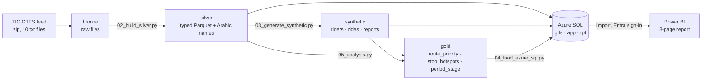

# Cairo Women-Only Transit — Data Platform

Graduation project (SQL · Python · Power BI · Azure). Question: **which Greater Cairo
routes and stops should a women-only transit service cover first?**

> ⚠️ Network data is real (Transport for Cairo GTFS 2025). Riders, rides and safety
> reports are **synthetic**, generated on top of that network — see
> [`docs/synthetic_data.md`](docs/synthetic_data.md). The project delivers a working
> pipeline and ranking method; swap in survey/HarassMap rows to get real conclusions.

## Architecture



| layer | where | what |
|---|---|---|
| bronze | `data/bronze/` | GTFS zip + raw `.txt`, untouched |
| silver | `data/silver/` | 10 typed Parquet tables, times → seconds, dates parsed, Arabic names joined |
| synthetic | `data/synthetic/` | 4,000 riders · 192,692 rides · 6,763 reports (seed 42) |
| gold | `data/gold/` | analysis outputs Power BI reads |
| serving | Azure SQL `cairo_transit` | schemas `gtfs` (feed), `app` (synthetic), `rpt` (dims, views, gold) |

## Data model (Azure SQL)
- **gtfs** — `agency → routes → trips → stop_times ← stops`, `trips → frequencies`,
  `calendar`, `shapes`, `translations`, `feed_info` (PK/FK enforced).
- **app** — `riders → rides → safety_reports`, linked to `gtfs.routes` / `gtfs.stops`.
- **rpt** — `dim_date`, views `vw_route_frequency`, `vw_stop_activity`, `vw_route_safety`,
  gold tables `route_priority`, `stop_hotspots`, `period_stage`.

## Azure (Azure for Students, cost $0)
- Resource group `rg-cairo-women-transit`, region **UAE North** (West/North Europe are
  blocked on the student subscription).
- Azure SQL server `sql-cairo-transit-mm`, **Microsoft Entra-only** sign-in (no SQL password).
- Database `cairo_transit` on the **free offer** (100,000 vCore-s + 32 GB / month),
  auto-pauses when the allowance runs out — no overage billing.
- Firewall rule `AllowAllIPs` (dynamic home IP). Protection relies on Entra sign-in;
  remove the rule after submission.

## Run it
```powershell
python -m venv .venv ; .\.venv\Scripts\Activate.ps1
pip install -r requirements.txt

python python\01_profile_gtfs.py data\bronze\gtfs_2025 docs\data_profile.md
python python\02_build_silver.py data\bronze\gtfs_2025 data\silver
python python\03_generate_synthetic.py data\silver data\synthetic
python python\05_analysis.py data\silver data\synthetic data\gold

# first load (creates everything, ~5 min, opens a Microsoft sign-in window)
python python\04_load_azure_sql.py data\silver data\synthetic data\gold --init=sql\01_schema.sql,sql\02_gold.sql
# refresh only the analysis tables
python python\04_load_azure_sql.py data\silver data\synthetic data\gold --init=sql\02_gold.sql --only=rpt
```
Needs ODBC Driver 17 (17.2+) or 18 for SQL Server.

## Power BI — `powerbi/cairo_women_transit.pbix`
Import mode, 9 tables + `_Measures` (13 measures) + `dim_period` (period sort order).
Model script: `powerbi/model_additions.tmdl` (paste into TMDL view → Apply).

| page | visuals |
|---|---|
| 1 Overview | KPIs (rides, reports, reports/1K, riders affected %, felt-safe), monthly trend, risk by operator, synthetic-data note |
| 2 Safety | heatmap period × journey stage, hotspot stop map (lon/lat scatter), incident types, slicers (period, age), riders affected by occupation |
| 3 Recommendation | top-10 launch routes, launch KPIs (10 routes · 3.1% of reports · 1.9% of rides), exposure-vs-risk scatter by tier |

## Results (synthetic — read [`docs/findings.md`](docs/findings.md))
- 81.7% of riders report ≥ 1 incident in 2025 (calibrated to the >80% ITDP/UN-Habitat figure).
- AM peak ≈ 40 vs midday ≈ 27 reports per 1,000 rides; on-board and waiting are the
  riskiest stages.
- Hotspots are major interchanges (Ramses, Ahmed Oraby Metro, Al Salam Tunnel exit).
- Operator and peak differences come from stated assumptions, not discoveries.

## Sources
- Transport for Cairo GTFS (Greater Cairo, 2025), CC-BY-NC-SA — via MobilityDatabase `mdb-3355`
- ITDP / UN-Habitat, Greater Cairo gender & public transport studies (calibration)
